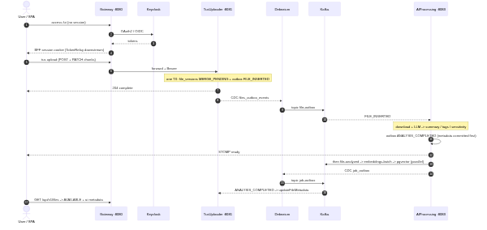
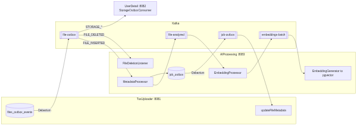
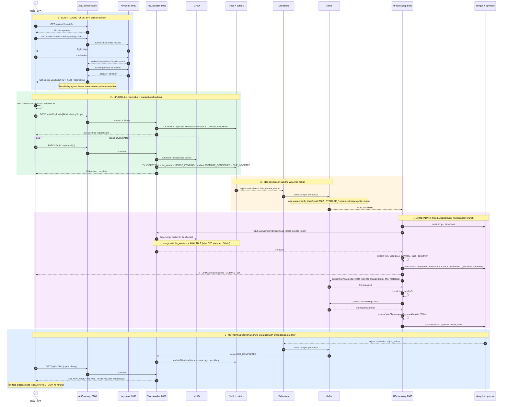
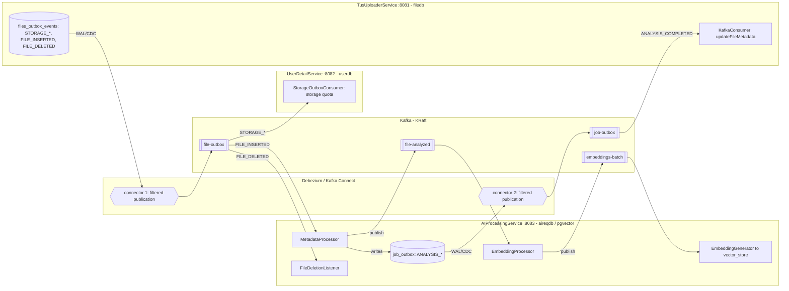

# Architecture flow: login → document availability

Two complementary views of the document portal. Both Mermaid blocks below render natively on
GitHub; pre-rendered images live alongside this file (`*.svg` / `*.png`).

-  — `flow-sequence.svg` / `.png`
-  — `cdc-topology.svg` / `.png`

---

## 1. End-to-end sequence (login → availability)

> Note on ordering: AI **metadata** is committed (`ANALYSIS_COMPLETED` → `job_outbox`) *before* the
> embedding branch is even kicked off (`file-analyzed`). The two run independently — embeddings never
> gate the metadata update. See `MetadataProcessor.kt:342` (metadata) vs `:188` (publish file-analyzed).

---

## 2. Debezium / Kafka CDC topology

Two independent transactional-outbox pipelines (one per service DB) plus two internal AI topics for
the embedding fan-out.

